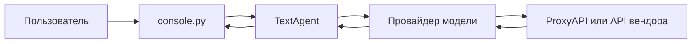

# Архитектура «Чат-маршрутизатор AI», версия 1.0

Чат — сменный интерфейс поверх одного ядра. Сейчас это консоль. Telegram, ВКонтакте и WhatsApp подключаются новыми интерфейсами и вызывают тот же метод агента `reply`.

Поток одного сообщения: ввод в консоли → `TextAgent.reply` дописывает реплику в историю → провайдер стримит куски `thinking` и `answer` → консоль печатает их сразу → в историю сохраняется только готовый ответ. При ошибке запроса реплика пользователя из истории убирается.

## Слои

| Модуль | Обязанность |
| --- | --- |
| `main.py` | Точка входа |
| `aichat/config.py` | Читает `.env` через python-dotenv |
| `aichat/providers.py` | Классы моделей и разбор стрима |
| `aichat/agents.py` | `TextAgent` и `VoiceAgent`, история диалога |
| `aichat/console.py` | Ввод и цветной вывод через Colorama |
| `tests/test_aichat.py` | Проверки без сети |

## Провайдеры

Общий интерфейс — метод `stream(messages)`. Он отдаёт `StreamPiece` с видом `thinking` или `answer`.

- `OpenAICompatibleProvider` обслуживает ProxyAPI, прямой OpenAI и DeepSeek. Формат запроса — Chat Completions, `stream: true`. Для ProxyAPI базовый адрес `https://api.proxyapi.ru/v1`, ключ передаётся как `Authorization: Bearer`, модель пишется как `вендор/имя`.
- `AnthropicProvider` ходит в Messages API напрямую. Системные реплики уходят в поле `system`. Бюджет думания задаётся `ANTHROPIC_THINKING_BUDGET`.

`build_provider` выбирает класс по `PROVIDER`. Новая модель добавляется новым классом и веткой в этой функции.

Разбор потока ProxyAPI пропускает последний служебный фрагмент: у него пустой `choices` и объект `usage`. Текст берётся из `delta.content`. Рассуждения, если модель их прислала, читаются из `reasoning_content` или `reasoning`. Сервис не всегда отдаёт сам ход думания.

Историю сервис не помнит. Каждый запрос отправляет весь список `messages`.

## Агенты

`TextAgent` ведёт текстовый диалог. `VoiceAgent` наследует его: текстовое ядро уже общее, а речь ProxyAPI (`/v1/audio/transcriptions` и `/v1/audio/speech`) подключается отдельным интерфейсом. Консоль сейчас запускает `TextAgent`.
